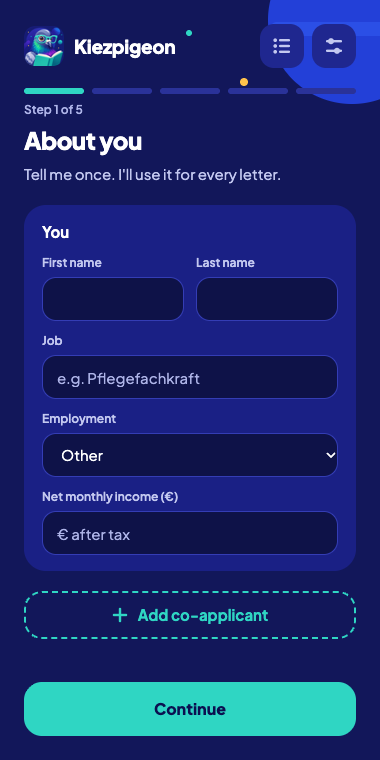
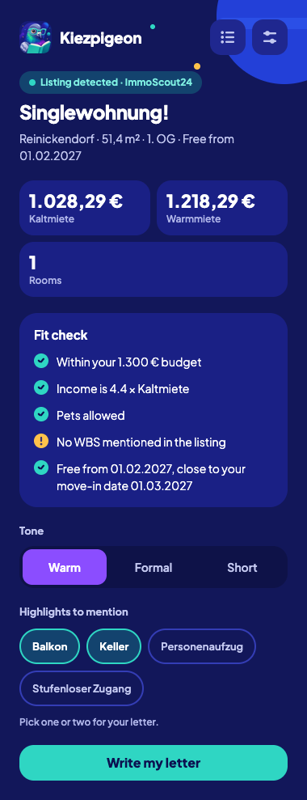
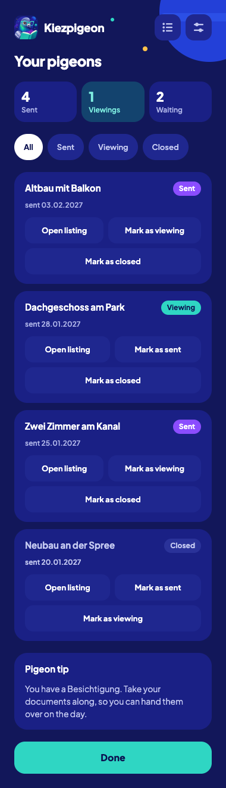

# Kiezpigeon

A Chrome extension for the Berlin flat hunt. Open a listing, open the side
panel: Kiezpigeon reads the listing, checks it against your profile, writes
a short German application letter and fills the listing's contact form.

**It never submits.** You review everything and press Send yourself.

**Your data stays on your device.** The only network request is the letter
call to Claude, made with your own API key when you ask for a letter.

## What it does

| 1. Onboarding                                    | 2. Listing detected                                          | 3. Letter ready                                      | 4. Your pigeons                            |
| ------------------------------------------------ | ------------------------------------------------------------ | ---------------------------------------------------- | ------------------------------------------ |
|  |  |  |  |

1. **Onboarding.** Five short steps: who is applying (one or two people,
   job, net income), the household (who moves in, pets, smoker, move-in,
   budget, contact details), a documents checklist, the letter's default
   tone, and your Claude key. You tell it once.
2. **Listing detected.** On an ImmoScout24 exposé the panel shows the
   rent, size and rooms, and a fit check with reasons: budget, income
   against three times the Kaltmiete, pets, WBS and the move-in date. It
   informs; it never blocks. You pick a tone and one or two highlights.
3. **Letter ready.** A German letter of at most 180 words, checked by a
   validator before you see it (no em dashes, no number that is not in your
   profile or the listing, the right salutation, honest about pets, your
   highlights mentioned). Switch tone, rewrite, edit or copy it. The form
   card says how many of the contact form's fields it can fill ("14 of 15
   matched"), which ones it leaves to you and which prefilled values it
   would replace. "Fill the form" fills; you press Send.
4. **Your pigeons.** When you tell it you sent the application, it is
   tracked as Sent, then Viewing or Closed, with counts and filters.

**Other sites.** On a listing outside ImmoScout24, "Use this page" reads
the page's contact form; you type the few listing facts the letter needs,
see every planned "field → value" pair, switch off any you do not want,
and only then fill.

Screenshots use an invented couple and a scrubbed saved page; `npm run
screenshots` regenerates them.

## Install (load unpacked)

Needs Node 24 (`nvm use` reads `.nvmrc`), Chrome, and a Claude API key from
the [Claude Console](https://platform.claude.com/settings/keys).

1. `git clone` this repository, then `npm ci`
2. `npm run build`
3. Open `chrome://extensions`, switch on Developer mode, click "Load
   unpacked" and choose `.output/chrome-mv3/`.
4. Open an ImmoScout24 listing and click the Kiezpigeon icon in the
   toolbar. The panel opens for that tab. Fill in your profile and paste
   your key in the last step (or later in Settings).

A tab that was open before you loaded the extension needs a reload before
Kiezpigeon can read it.

## Privacy

- **What is stored:** your profile (applicants, income, household, move-in,
  contact details, budget, documents checklist), your settings (model), the
  applications you marked as sent (listing title and address, the letter,
  status, dates), and your API key.
- **Where:** in Chrome's local extension storage on this computer
  (`chrome.storage.local`). Nothing is synced to your Google account and
  there is no Kiezpigeon server.
- **Not encrypted:** anyone with access to your Chrome profile can read
  this data, including the key.
- **Documents are flags only:** the checklist records "ready" or "pending";
  no file is ever read, stored or uploaded.
- **The one network call:** when you click "Write my letter" (or Rewrite,
  or switch tone), the service worker sends your profile facts and the
  listing facts to `https://api.anthropic.com` with your key. That is the
  only destination in the manifest. You pay Anthropic for your own usage,
  usually around a cent a letter on the default model. No analytics, no
  telemetry, no remote logging.
- **What it reads:** only the tab you opened the panel on, when you open
  it. No background fetches, no crawling. On other sites it reads the page
  only after you click the icon and "Use this page" (`activeTab`).
- **Export, import, delete all:** Settings exports your profile and
  applications to a JSON file (never the key), imports such a file back,
  and deletes all data, key included, in one click.

## Never submits, and how that is tested

Filling sets field values with the browser's own setter and fires the
`input` and `change` events a React form needs. No code path clicks a
button, calls `form.submit()` or `requestSubmit()`, dispatches a `submit`
event or sends a key. Consent and opt-in checkboxes are left as the page
has them; file inputs are never touched.

- `src/fill/fill.test.tsx` fills the scrubbed contact form fixtures and
  records every submit, click and key event: there must be none.
- `e2e/never-submit.spec.ts` loads the built extension in Chromium, serves
  the fixture at an ImmoScout24 address, presses "Fill the form" and asserts
  that the page never loaded a second time and saw no submit, click, key or
  focus event. `e2e/fallback.spec.ts` does the same for an unknown site.
- Both were mutation-checked: adding `requestSubmit()` or `submit()` to the
  fill handler makes them fail (`docs/ai-workflow.md`).

## Development

- `npm run dev`: WXT with live reload
- `npm run lint && npm test && npm run build`: before a pull request
  (`npm test` typechecks first)
- `npm run test:e2e`: builds, then the Playwright runs
- `npm run tokens`: regenerates `src/styles/tokens.css` from
  `design/tokens.json` (never edit the CSS by hand)

## How it was built

Planned and built with Claude Code, one phase per session and per pull
request. Read in this order:

- [PLAN.md](PLAN.md): goals, tiers, test tiers, definition of done
- [CLAUDE.md](CLAUDE.md): the working agreement and product invariants
- [docs/decisions.md](docs/decisions.md): thirteen ADRs
- [docs/ai-workflow.md](docs/ai-workflow.md): every place the AI got it
  wrong, and a narrative per phase
- [PHASES.md](PHASES.md): the phase specs

## Not affiliated

Kiezpigeon is not affiliated with ImmoScout24 or any listing site. It reads
the one page you have open and fills fields you would otherwise type; you
are responsible for using it within each site's terms.

MIT licence.
